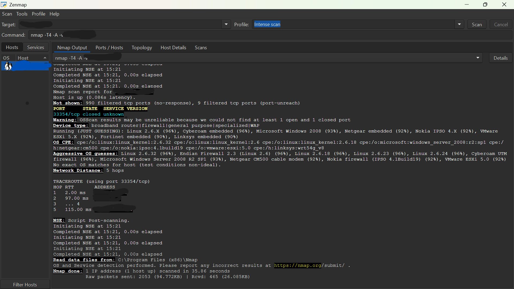

# Port Scanning with Nmap

## Objective
Scan my own public IP address to see which ports are visible from the internet and what a scan reveals about the device.

## Tool
Nmap, run through the Zenmap GUI with the Intense scan profile.

## Command
`nmap -T4 -A -v x.x.x.x`

- `-T4`: faster timing template
- `-A`: OS detection, version detection, script scanning and traceroute
- `-v`: verbose output

## Scope
I scanned only my own IP address, which has been redacted. The scan was run from home Wi-Fi.

## Findings
- The host was up, with 0.086s latency.
- 999 of the 1,000 scanned ports were filtered (990 with no response, 9 returning port-unreachable), which suggests a firewall or router dropping unsolicited traffic.
- One port, 33354/tcp, was closed, with an unknown service.
- No open ports were found, so there were no services to identify.
- Nmap warned that OS detection was unreliable for that reason. Its guesses included a broadband router or firewall.

## What I learned

**Port states.** Nmap labels each port based on how the target responds:
- **Open:** a service is listening and accepts connections, so other devices on the network can reach it.
- **Closed:** the port is reachable, but no service is listening on it. The host replies to say so, which also shows the host is alive.
- **Filtered:** Nmap gets no reply, or only an error, because a firewall or router is dropping or blocking the probes. Nmap can't tell whether the port is open or closed behind it.

**My result.** My router or firewall is blocking almost all unsolicited traffic from outside. Port 33354 was reachable but had no service on it, so nothing was exposed.

**Other things I noticed.** Nmap warned that OS detection might be unreliable because it needs at least one open and one closed port, and I only had a closed one. Its guesses were scattered across routers, firewalls and several operating systems, which fits that warning. The traceroute also used the closed port, 33354.

**Takeaway.** Filtered and closed ports reduce what an attacker can reach, but "filtered" doesn't mean "secure". It only means my scan couldn't see past the firewall, and a scan only shows what's visible from one position at one time.
